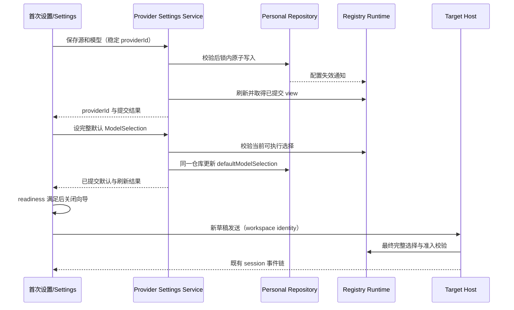

# 无官方账号的三协议 API 工作台

状态：决策已确认，分阶段实现中；本文不表示所有功能已经交付。日期：2026-10-12。

源码基线：`v3.15.1`，`aac4755666d09fdcd70272fcf063c077a639015f`。初次交付仅包含文档和功能关系索引。2026-10-12 用户确认 D01–D05（备份 30 天）并授权按阶段实现；仍不修改真实用户数据。

## 文档入口

- [分阶段实施与文件清单](implementation-phases.md)：阶段依赖、改动文件、每阶段保留功能和出口门禁。
- [数据迁移与验收](migration-and-acceptance.md)：迁移事务、失败恢复、场景目录、覆盖矩阵和已确认决策。

本文定义目标产品规则。既有 spec 在实现切换前仍描述当前版本行为；只有通过各阶段门禁后，才把旧登录、Coding Plan 和云业务文档标记为退役。

## 1. 目标与范围

用户已确认：彻底移除官方登录及关联云业务；用户无需注册 ZCode、Z.ai 或 BigModel 账号即可进入工作台，直接配置符合以下协议之一的模型 API：

| 协议标识                  | 执行适配器                     | 配置含义                                                         |
| ------------------------- | ------------------------------ | ---------------------------------------------------------------- |
| `anthropic-messages`      | 现有 Anthropic adapter         | Messages 兼容接口；选择该协议不意味着必须使用 Anthropic 官方域名 |
| `openai-chat-completions` | 现有 OpenAI-compatible adapter | Chat Completions 兼容接口                                        |
| `openai-responses`        | 现有 OpenAI Responses adapter  | Responses 兼容接口                                               |

这里的“任意”指用户可填写厂商、自建代理或本地服务的地址与模型 ID，且接口满足所选协议及本应用所用的流式、工具调用等能力合同。三种协议之间不自动降级；Azure 特有部署路径、动态 OAuth、SigV4、mTLS 等额外鉴权或接口变体不因协议名称相同而自动获得支持。

### 1.1 移除的业务

| 业务                                                                  | 目标规则                                                                           | 历史数据规则                                                               |
| --------------------------------------------------------------------- | ---------------------------------------------------------------------------------- | -------------------------------------------------------------------------- |
| 官方 OAuth、用户档案、账号域、登录回调、JWT 刷新/失效重登录           | 无登录入口、账号身份和自动注册要求；不再注册相应 Service、轮询或回调消费者         | 只清理明确属于官方应用账号的设置和凭据，不清空公共凭据仓库                 |
| Start / Individual / Team Coding Plan、账号 Project Token、组织及额度 | 不再用权益或账号连接判定模型是否可选；移除购买、续费、升级、额度重置、套餐用量查询 | 失效的官方模型引用保留诊断与历史，不能伪装为普通 API 凭据                  |
| Off-Peak、Highspeed                                                   | 停止取号、抽卡、调度、核销、加速推理和云分享；不把它们改造成普通定时任务           | 本地记录和已产生的普通 task/session 保留；未终态闲时任务停止派发并本地终结 |
| 官方 MCP 授权发放、套餐配额                                           | 移除官方预置凭据/额度业务                                                          | 普通用户配置的 MCP 与其 OAuth 完整保留；官方预置停用并可诊断               |
| 对话云分享、云预览、云导入、分享权限                                  | 移除新发布、上传、查询和在线导入流程；旧分享深链返回明确的退役提示                 | 已导入的本地正文、附件和来源信息继续可读；历史 URL 不触发自动云请求        |
| 云反馈工单、上传和进度通知                                            | 移除提交、补充、云状态轮询及后台上传                                               | 已有本地摘要/附件不自动删除或上传；保留本地诊断导出能力                    |
| Rewards / Referrals、Marketing Touch                                  | 移除云活动、拉新、奖励 Webview、营销弹窗和业务触达                                 | 缓存退役，不再驱动业务；不因旧深链唤起登录                                 |
| 官方业务事件、账号归因、模型 trace 上报                               | 不再向官方业务云报告会话、模型请求或账号事件                                       | 本地日志、错误诊断、性能观察与模型 usage 仍保留                            |

### 1.2 必须保留的功能

1. 本地与 SSH 远程 workspace、文件和 Git 操作、终端、工具调用、权限审批、任务历史、附件、fork/rewind/compact、队列和恢复。
2. 普通 automation/cron、Bots、Subagents、Skills、插件与 MCP；这些入口都使用各自保存的模型选择和鉴权，不继承一个新建的全局账号状态。
3. 三协议流式回答、取消、超时、重试及原始厂商错误诊断；多模态、reasoning、工具调用等按模型配置能力开放。
4. 本地模型用量统计、上下文用量、资源管理与本地日志导出；云套餐额度与本地模型 usage 是两个业务。
5. 手机二维码远控 `/remote` 与既有 attachment、配对 token、Host owner/lease、跨 Host 路由和重连；移除依赖官方 OAuth 的网页入口时，不削弱远控鉴权。
6. Windows、macOS、Linux；桌面与手机 Web 的主题、语言、响应式布局与 `IPlatformService` 边界。

普通 Z.ai / BigModel API Key 接口仍属于可配置厂商 API。不能按名称批量删除其模板、模型、Logo，或删掉独立的 MCP OAuth、SSH、Bot token、二维码配对凭据。

### 1.3 公共网络与另行决策

移除账号关联业务不等于断开一切官方公共基础设施。此方案暂保留不依赖官方账号的版本更新、公共插件目录、公共模型目录、公共 ClientConfig 和远控 relay。每一项必须单独证明不携带应用账号凭据、不启动云业务，并支持相应的缓存/失败路径。

公共模型目录仍可能包含旧 account provider，消费者必须在完整验证前按目录版本/适配规则过滤，不能让远端刷新重新生成已移除的账号 provider。若上游未发布兼容目录，使用经过验证的打包目录；不得假设上游会同步改动。公共 ClientConfig 的强制更新、插件分类、风险链接及远控开关应保留必要的公共投影/本地默认值，不能因删掉整个服务而意外关闭保留功能。

[已确认决策 D01/D02](migration-and-acceptance.md#7-已确认决策)：独立崩溃/性能云上报默认关闭，保留本地观察，本轮不增加 opt-in 开关；公共分发与 relay 本轮保留无账号访问，自托管另案。

## 2. 当前实现与改动层

这是跨域产品裁剪和配置入口改造，涉及全部七层：`presentation`、`option-source`、`draft-default`、`validation`、`commit-effect`、`persistence`、`recovery`。

| 已确认的现状                                             | 证据种子                                                                                                                        | 目标影响                                                 |
| -------------------------------------------------------- | ------------------------------------------------------------------------------------------------------------------------------- | -------------------------------------------------------- |
| 启动判断含账号域为空，或未登录且无可用 provider 两个条件 | packages/ui/src/root/useProviderAvailabilityLoginEntryGuard.ts                                                                  | 去掉账号域/用户事实，按配置 readiness 展示可跳过模型设置 |
| 首次 API Key 仅 Z.ai/BigModel，skip 写账号域             | packages/ui/src/login/LoginApiKeyForm.helpers.ts、LoginApiKeyForm.tsx                                                           | 三协议通用表单，skip 不创建假域/provider                 |
| default 仓库已存在，公共选择服务仍是读取面               | packages/services/src/model-provider/providerFacadeServices.ts、packages/provider-node/src/model-selection-config-repository.ts | 复用同一 Personal owner 的受控默认写入口                 |
| 三协议 enum 已有，普通源要求非空 Key，headers 未完整暴露 | packages/provider/src/config/provider-data-schema.ts、ProviderDraftSave.ts                                                      | 通用鉴权、headers 与完整配置校验                         |
| 账号权益影响 Registry，并存在按账号连接重映射            | packages/provider/src/resolver.ts、effective-model-selection.ts                                                                 | 退休账号特例，保留精确 provider/model 身份               |
| 三协议 SDK factory 已有，部分端点默认转官方 gateway      | apps/zcode-cli/packages/adapters/src/model/model-execution.ts、official-coding-plan-gateway.ts                                  | 通用配置端点直达                                         |
| 无模型阻断执行/预热，历史仍可只读 Agent                  | packages/ui/src/v4/composer/useDraftModelReadinessGate.ts、packages/desktop/test/e2e/provider-readiness-agent-startup.test.ts   | 保留只读浏览与执行准入隔离                               |
| Personal v1；provisioning v1/v2 含账号 projection        | packages/provider-node/src/provider-config-file-codec.ts、packages/shared/src/provider-provisioning.ts                          | 版本化迁移和写前拒绝不兼容 peer                          |

## 3. 产品规则

### 3.1 首次启动和配置入口

- 首次本地启动，无可执行模型时打开“配置模型 API”，展示自定义源及现有普通厂商模板，不按语言锁定厂商。语言只影响文案。
- 用户可跳过进入工作台。无模型时保留草稿、历史和设置入口；发送/预热/需要模型的后台执行被 readiness 阻断，并指向配置，不展示官方升级入口。
- 已有可执行普通 API 配置的用户直接进入工作台；旧账号域是否存在不参与判断。
- 首次保存并选择默认模型后，应能从真实 cwd 开始新对话。无项目时复用 `fileService.ensureConversationWorkspace()`，UI 仍显示未选择项目。手动设置不额外创建项目或修改当前 workspace。
- 手机远控复用目标 Host 模型配置，不打开本地注册/配置向导；远端模型不可用时返回目标 Host 的诊断和相应配置入口。
- 多窗口保存不能依赖延时：mutation 完成 → owner 刷新 → 返回/读取包含该提交的 view → readiness 更新 → 关闭向导。旧请求响应不得覆盖新的草稿或关闭后重开向导。
- 保存、设默认、可选连通性测试分开显示结果。连通性测试失败不把已保存配置伪装成未保存；保存合法配置不意味着 Key/网络已验证。测试使用服务和真实本地 cwd，不由 UI 直接 fetch。

### 3.2 通用供应商与鉴权

新字段名和命令名是设计提案，实施时在公开类型处定稿；以下语义是本 spec 的目标合同。

| 配置项            | 规则                                                                                                                                           |
| ----------------- | ---------------------------------------------------------------------------------------------------------------------------------------------- |
| provider          | 稳定且唯一的 providerId、用户名称、可选厂商模板来源；同厂商可有多个独立源                                                                      |
| protocol          | 必选三种协议之一；不按 hostname 猜测，不发生隐式 fallback                                                                                      |
| base URL          | 用户填写 API 根前缀；允许 `http` / `https`，包含本地服务；拒绝 URL 内嵌凭据；表单说明最终协议路径                                              |
| API 路径          | 按适配器合同拼接一次，校验 `/v1`、尾斜杠、代理前缀和 Responses/Chat/Messages 路径；已有 OpenAI-compatible 路径归一化需保留兼容，不盲目二次追加 |
| auth mode（提案） | `api-key`、`custom-headers`、`none`；第一阶段优先验证 `api-key`，其余属于通用接口完成门禁                                                      |
| `api-key`         | 明确的非空 Key；按协议约定生成鉴权头；无需应用 JWT；不使用虚构 Key                                                                             |
| `custom-headers`  | 用户显式配置鉴权头等 headers；不额外生成官方鉴权，不从 SDK 环境变量偷取 Key                                                                    |
| `none`            | 不需要 Key，不生成 Authorization/x-api-key；即使进程环境有 SDK Key 也不回退；适用于无鉴权本地兼容服务                                          |
| headers           | 校验名称、值及 CR/LF；保留大小写不敏感语义；与协议自动鉴权头冲突时阻止保存并提示切换 custom-headers，禁止无提示覆盖                            |
| 基础传输头        | 内容类型、流式协商和协议版本头按 adapter 生成；不可由用户制造矛盾配置；具体保留头集合在 S1 定稿并补测试                                        |
| secrets           | 沿用私有 Personal 配置和可信 provisioning 边界；UI 诊断、日志、网络证据脱敏；不把 Key 同步到普通 AppSettings、主题广播或 relay 业务日志        |

模板是可编辑初始值，不是身份/权益。普通供应商可启停、改名、排序、添加模型、编辑 URL 和 headers；通用连接不读取账号域、团队、套餐或官方注册状态。

普通源的工作分组统一为现有通用 `standard-personal`（或实施时定稿的等价通用分组），不再有 `zai-family` / `bigmodel-family` 运行域。厂商名称、Logo 与模板归属只是展示元数据，不改变候选过滤、鉴权或执行准入。

S1 实施合同：暂在普通 `access.type: api-key` 上新增可选 `authMode`（`api-key` / `custom-headers` / `none`），未声明时按旧版 api-key 读取，不改变旧文件的正常字段。此为通用鉴权的唯一状态来源；运行时、连通性测试和表单均读取该字段，不从 hostname、Key 是否为空或用户状态推测模式。显式模式的 api-key 禁止配置鉴权头；none 禁止 Authorization/x-api-key；custom-headers 只使用已配置的头且不保留 apiKey。旧专用 Coding Plan access 不支持 none/custom，待 S5 退役。

S4/D01 bootstrap 合同：Desktop Main 不调用 ARMS init，不注入 Browser SDK、不启动云 crash collector/reporter；preload/renderer 的公开 bootstrap 入口直接返回，不重试桥接或注册 load 事件。主进程现有本地诊断、进程资源视图/usage 和日志继续运行；crash capture 显式 `remoteCrashReporterEnabled=false`，本地 dump uploader 关闭；SDK 初始化退出后，所有启动 `setConfig` 调用同步退出，避免未初始化异常阻断窗口；云 SDK 不因 endpoint 环境变量重新启用。用于归因/脱敏的纯函数与本地 E2E 观测暂保留到收尾，不作为联网初始化入口。本轮无设置开关或 opt-in。

完整执行 schema 校验 HTTP/HTTPS URL（不含 userinfo）、HTTP header 名称和值、大小写重复及协议保留头。保留头为 Content-Type（仅 application/json）、Accept（不允许用户覆盖流式协商）、Anthropic-Version（仅 Messages 协议允许 2023-06-01）；违反时阻断执行并保留编辑草稿。SDK 要求 Key 参数的 factory 在 none/custom 中显式传空值阻止读取环境变量；协议 fetch 边界去除 SDK 自动鉴权，再只恢复 custom 的显式鉴权头，不持久化或发送虚构 Key。普通 provider 跳过官方路由；S1 增量期间旧 account provider 的路由保留到 S5，不能把中间版本作为账号已移除发行。

### 3.3 模型能力和默认模型

- 用户可填写精确 modelId，不能强制依赖 `/models` 列表请求。公共模板提供初始能力，手动模型必须具备完整可验证配置。
- 工具调用、context window、max output、输入模态、reasoning、JSON schema/native web search 等按能力声明处理。没有工具能力的模型不能因“协议兼容”被宣称支持工具；具体功能入口服从能力校验。
- 不支持 reasoning 的模型须有不会产生 reasoning wire 参数的完整选择。优先复用现有单值、中性 reasoning 配置与空映射；是否调整领域类型见 D03，不能构造虚假的厂商推理级别。
- S1 手动编辑开放 `supportsToolCall`，旧手动规则未声明时继续继承系统能力；编辑器保存固定模式可冻结该显式能力。`requiresMfjsToolSchema`、输出格式与 max-output 协议映射仍是系统字段。提供“禁用推理参数”操作，将同一草稿的 reasoning values/map 设为 `disabled` / `{}`；不新增第二个 reasoning 状态。
- “保存并设为默认”写入 `provider_config.json` 的 `config.defaultModelSelection`。提交前由同一配置 owner 校验 provider 存在且启用、model 存在且完整、reasoning 合法。
- 默认模型影响未来未指定选择的草稿。既有 workspace Recent、会话历史选择、Active Model、队列已接受输入、automation/Subagent 明确选择不能被全局默认批量覆盖。
- 保留现有 configured default / Registry preferred 的新草稿选择链；删除失效官方默认后，可按新草稿规则提示选择现存可用源。显式保存的失效会话/automation 模型不能跨厂商同名映射。
- 保存 provider 成功但设默认失败时显示可重试的部分完成态，复用同一 providerId，不能再次点击生成重复供应商。执行请求仍以 Host 最新校验为准。

### 3.4 执行与错误

配置模型请求直接到所填 endpoint；彻底取消隐式官方网关重写、JWT 注入、官方 account key 解析、Off-Peak ticket 与 Highspeed override。显式配置一个代理 URL 是合法用户配置。

保留代理、CA/TLS、取消信号、连接/请求超时、流式 usage、工具调用和通用错误处理。厂商 401/403/429、错误 SSE、流中断、空响应应保持可诊断，不转换成官方注册、续费、抢号或账号重登录流程。仅适用于退役业务的错误码、重试或安全校验可删除；公共通用安全/传输边界不能靠文件名批量删除。当前公开 `request-security-edition` 是透传实现，不能把它描述为已证实的注册障碍。

## 4. UI Surface Matrix

| 入口/场景                          | 共享实现与局部状态                                     | 默认/候选来源                         | 校验与提交                                      | 权威 owner / sink                      | 平台差异与隔离                                            |
| ---------------------------------- | ------------------------------------------------------ | ------------------------------------- | ----------------------------------------------- | -------------------------------------- | --------------------------------------------------------- |
| 首次本地模型设置                   | Root + 拟新增通用设置页；表单草稿在组件内              | 模板/三协议选择；不读 OAuth           | Settings service 保存、默认命令、刷新 readiness | Config Runtime / Personal Repo         | 只在启动完成后按需创建默认 conversation cwd               |
| 设置页添加/编辑源                  | `useModelProviders`、ProviderDraftSave、MetadataDialog | ProviderSettingsView                  | 同一配置 mutation 和完整 schema                 | ProviderSettingsFacade / Personal Repo | 不修改打开会话的 Active Model；本地设置不误用远端路径测试 |
| 空草稿发送/预热                    | `useDraftModelReadinessGate`、SessionPane；本地 draft  | ModelSelectionView / workspace Recent | UI readiness + Host 最终准入                    | Host / CLI runtime                     | 跳过可读历史；readiness 不等于网络健康                    |
| 既有会话模型切换                   | ModelConfigSelect、会话 draft                          | 相同 Registry 候选                    | 原会话命令和完整 selection 校验                 | session/runtime / session snapshot     | 同名模型不能跨 provider 重绑；Active Model 按现有生命周期 |
| 普通定时任务                       | AutomationsSection / automation Store                  | Registry + 记录的 selection           | 原 automation service                           | automation repo / scheduler            | 只删同页 Off-Peak 部分，保留 cron 与原 owner              |
| Subagent / Bot 模型                | 各设置入口与运行配置                                   | profile/记录中明确选择                | 原配置服务与 runtime 校验                       | 原 profile/Bot/session owner           | 不跟随新全局默认改写显式选择；渠道 token 保留             |
| 手机远控与 SSH workspace           | remote shell / shared model picker                     | 目标 Host view                        | 配对鉴权、owner/lease、target 校验              | 既有 Host attachment / remote registry | `/remote` 保留；desktop-continuous 与 replayable 语义分开 |
| 套餐、闲时、加速、云分享/反馈/营销 | 多个独立 Store/Service，目前部分由 Root/App 挂载       | 云状态/账号                           | 退役入口与 producer，不再调用                   | 本地历史归档，云 owner 不再连接        | 不保留隐形轮询、自动上传或过期重登录                      |

## 5. 状态所有者、接口和事件顺序

| 状态/事实                      | 唯一 owner                           | UI/缓存                                        | 写入接口与持久化                                                                                       |
| ------------------------------ | ------------------------------------ | ---------------------------------------------- | ------------------------------------------------------------------------------------------------------ |
| provider/model/default 配置    | Config Runtime + Personal Repository | ProviderSettingsView / ModelSelectionView      | 现有 settings mutations；`saveGenericSetup` / `saveConfiguredDefault`；同一私有 `provider_config.json` |
| Registry revision / 可执行模型 | Provider Registry Runtime            | hooks 缓存，按 service/request generation 失效 | 配置 owner 刷新；不由 UI 合并官方账号结果                                                              |
| 首次向导草稿和可见性           | Root / 页面组件                      | 未提交表单与当前请求状态                       | 记忆跨启动跳过偏好（D04），由 settings owner 持久化；不改其他配置                                      |
| 会话 Active Model、已接受输入  | CLI runtime / CommandInbox           | Renderer optimistic overlay                    | 既有 session 命令与 snapshot；默认模型不直接写这里                                                     |
| 远端配置投影                   | Target Environment 的 Config Runtime | Main 仅协调、连接表仅路由                      | provisioning v3（提案），可信通道传私有配置，Target 原子验证/应用/刷新                                 |
| 迁移完成状态                   | 各持久化 owner + 拟新增迁移 journal  | 脱敏 migration summary                         | owner 自己的锁/事务；journal 只记录阶段，不拥有配置副本                                                |
| 旧 Off-Peak / 云业务本地记录   | 原 repo 的迁移/只读边界              | 退役诊断                                       | 无云写入；终态迁移及历史不删除                                                                         |

公共模型选择服务当前是读取接口，默认写入应放配置命令侧并经公开导出注入。UI 通过 `packages/ui/src/hooks/` 调用服务；不直接访问 Repo，不通过 `window.zcode` 绕过 `IPlatformService`。禁止为“免注册”再造一套 providers localStorage。



远端流程及迁移顺序见 [迁移文档](migration-and-acceptance.md)。上述返回字段的具体类型在 S0/S1 定稿；不得以 `setTimeout` 代替提交、刷新和 owner 确认。

## 6. 必须保持的不变量

| 不变量                                             | 受影响边界                                 | 必需证据                                           |
| -------------------------------------------------- | ------------------------------------------ | -------------------------------------------------- | ------------------------------- | ------------------------------------------------- |
| 身份 key 为 `workspaceIdentity?.trim()             |                                            | workspacePath`；路径仅用于 cwd/Git/展示            | 本地、SSH、手机、缓存/队列/恢复 | 相同 path 不同 identity、remoteSessionId 关联断言 |
| Main/relay 不保存 task/session、队列或模型执行事实 | provisioning、远控                         | 可信通道/attachment 与 owner 路由；日志无秘密      |
| 新默认不覆盖会话 Active Model/已 admission 队列    | 切换、running/queued、Subagent             | runtime/协议实际模型选择与队列内容断言             |
| 空配置能读历史，不能发模型请求或预热               | 启动/skip/readiness                        | 历史 UI + 只读 Agent + 模型请求数量为零            |
| 三协议不进行官方重写或账号依赖                     | Adapter、CLI、Host                         | 每协议最终 URL、headers、body、流式/工具请求证据   |
| 无默认时仍能保存草稿；显式失效模型不跨厂商映射     | Recent、历史、automation                   | 持久化引用不变，执行前可诊断阻断                   |
| 独立认证不被删掉                                   | MCP OAuth、SSH、Bots、远控                 | 升级前后凭据集合与连接/配对验收                    |
| 云业务停止后不会因匿名挂载、401 或旧回调复活       | Root/App/service registration              | 干净安装与旧数据升级的网络 allowlist/denylist 证据 |
| Migration 失败不得把旧文件改为空；成功可重入       | 私有 JSON、settings、SQLite、credentials   | 故障注入、幂等、损坏/高版本文件原样保留            |
| 两种实时链路合同不合并                             | desktop-continuous / web-remote-replayable | desktop 连续流及 mobile 断连 replay 分别验证       |

## 7. 影响关系与调查证据

| 等级           | 上游 → 下游关系                                                | 为什么检查                                 | 证据/扩展深度                                                 |
| -------------- | -------------------------------------------------------------- | ------------------------------------------ | ------------------------------------------------------------- |
| must-inspect   | provider schema → resolver/facade → model execution            | 配置完整性、身份与鉴权决定真实请求         | schema、resolver、model-execution；语义两跳                   |
| must-inspect   | 启动向导 → default write → draft readiness                     | “配置完成”必须落盘且能创建完整选择         | Root/LoginApiKeyForm、repository、newTaskDraft；两跳          |
| must-inspect   | OAuth/settings/credentials → 云 producer                       | 只移除 UI 会留下后台查询、上传和重登       | services/node.ts、Root/App、各云 Service；按 owner 三跳       |
| must-inspect   | Personal config → provisioning Source/Target → remote Registry | 新旧版本兼容和私有数据范围                 | provider-provisioning、Source/Target、coordinator；两跳       |
| should-inspect | shared model picker → automation/Subagent/Bot                  | 共享候选但写入 owner 不同                  | 各业务 service 与 stored selection；两跳                      |
| conditional    | public catalog/ClientConfig → 保留的插件/远控/更新             | 保留公共请求时防止账号 provider 回流       | clientConfigService、builtin download、manifestUpdateProvider |
| invariant-only | credential store → MCP/SSH/Bot/配对                            | 共享仓库不意味着都是官方账号               | credential service 与独立 auth 模块                           |
| evidence-only  | readiness / login / migration tests                            | 提供当前路径证据，不能当作未来方案完成证据 | 既有 UI/provider 单测及 provider-readiness E2E                |

本次没有可调用的 codegraph 索引工具；使用功能图种子、源码读取、精确 `rg` 调用点追踪。上表的深度是语义调查范围，不伪称执行了索引 impact 查询。未来实施前需按目标模块运行架构检查/受控上下文，并用可用的索引复核种子。

### 图漂移与图增量

- `graph-drift-candidate`：既有图中 provider 领域覆盖广，但首次默认模型写入、通用鉴权、云业务全退役的组合缺少统一 spec 入口。
- 已确认产品范围节点 `capability.generic-api-only-workbench-plan` 记录 staged 状态：S1/S2 通用配置/执行/向导已有代码，S3 文件和 v3 分发边界、D01 关闭 bootstrap 已实现；官方业务全面退役仍未完成，链接 Registry、model selection、provisioning 和传输边界。不能把旧能力节点删掉或宣称功能已经移除。
- 新通用页面/默认写命令/迁移 owner 的代码种子须在实现后补回，不预填不存在的符号；旧 OAuth/云节点在实际删源后同步移除引用。
- 索引检查发现基线已有 4 条悬空关系，涉及 `persistence.desktop-user-data-root` 与 `surface.customize-capability-settings`；与 HEAD 对照确认本次未新增悬空关系。为避免扩展无关文档改动，保留并记录该漂移；staged 节点的 6 个现存代码种子、3 份文档和 6 条关系目标均已核实。没有 codegraph 工具，因此未执行索引符号解析。

## 8. 交付边界

本次交付：本 spec、阶段文件清单、迁移/验收目录，以及当前登录文档、会话场景目录、覆盖矩阵的计划入口。初次文档交付时功能/迁移/E2E 未开始；当前按阶段进入实施，具体状态与实际证据回填阶段文档。

S0–S6 每一阶段的验收以实际证据为准。任何方案中出现的新增 schema、命令或文件都标为拟新增/提案，不应被下游当成当前可用接口。D01–D05 已确认；未来出现的范围变化须记录，未完成验收仍保持未完成状态。

## S2 实施合同（2026-10-12）

首次入口改为 `ModelSetupPage`，仅消费通用模型配置，不等待官方 OAuth；手机远控仍绕过本地入口。`AppSettings.modelSetupSkipped` 由 SettingService 唯一持久化，启动等待 settings/selection 水合后，只在无可用模型且未跳过时弹出。手动进入设置不受 skip 限制。无模型时保留历史与草稿，发送/预热继续由已有 readiness gate 阻断。

`ProviderSettingsService.saveGenericSetup` 通过 Facade → ConfigService → PersonalRepository，在同一次事务内写入 source、手动 model、完整 configured default。输入含稳定 UUID `setupId`；提交后刷新失败重试使用同一 ID，同内容重放不会新增源，不同内容冲突拒绝。所有完整性校验先于写盘，错误不回显 Key/headers。设置里的已有模型通过 `saveConfiguredDefault({selection,basedOnRevision})` 写入同一 Personal 文件；Host 在事务内验证已发布快照和 Personal revision，拒绝失效/隐藏模型和缺失档位。ModelSelectionService 保持只读，默认变化只影响后续新草稿。

向导复用协议选择、鉴权/headers、Key 输入组件；任意 modelId、context window、max output 和工具支持明确填写。首次提供无推理参数的通用模型，完整 selection 档位为 disabled，map 为 `{}`；高级能力/推理继续在已有模型设置编辑。该初始能力是用户确认的配置，不发起 `/models` 探测。配置成功后更新 settings 并读取新 Host view，再关闭入口；若事务已提交但刷新/settings 失败，保留 setupId 重试，不重复创建。已有模型可直接保存为默认并完成。

```mermaid
sequenceDiagram
  participant UI as ModelSetupPage
  participant S as ProviderSettingsService
  participant F as ProviderSettingsFacade
  participant P as PersonalRepository
  participant R as Registry/Selection view
  UI->>S: saveGenericSetup(stable setupId, validated draft)
  S->>F: command admission
  F->>P: atomic source + model + default
  P-->>R: config invalidation
  F->>R: refresh after commit
  R-->>UI: committed view
  UI->>UI: SettingService clears skip; reads Selection
  UI->>UI: complete and ensure actual workspace cwd
```

验收增补：干净安装直接看到三协议通用入口；无账号/域也能使用已有通用模型；skip 后重启不弹出、发送仍阻断；水合未完成不误判；无效地址/headers/能力不写入；双击与刷新失败重试只产生一个源；默认写入不改变历史会话或 Active Model；两窗口 revision 冲突不覆盖；手机 `/remote` 入口保持 attachment 行为。
