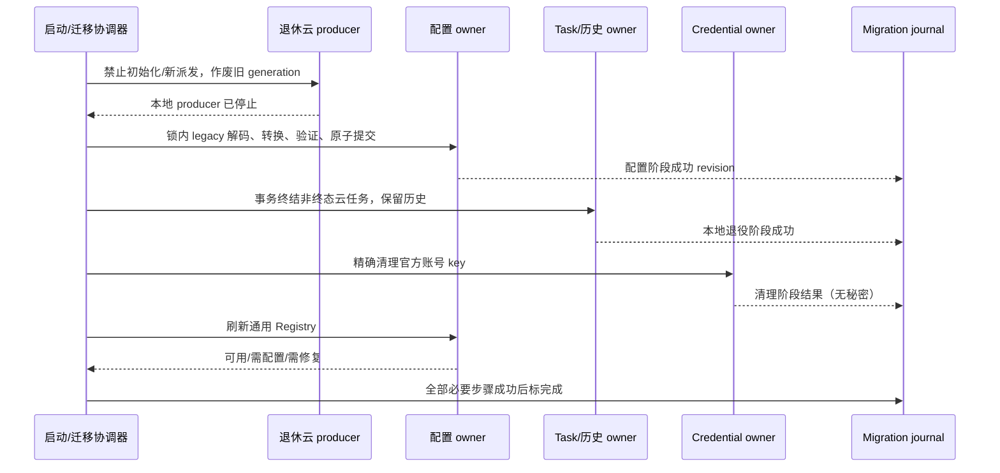
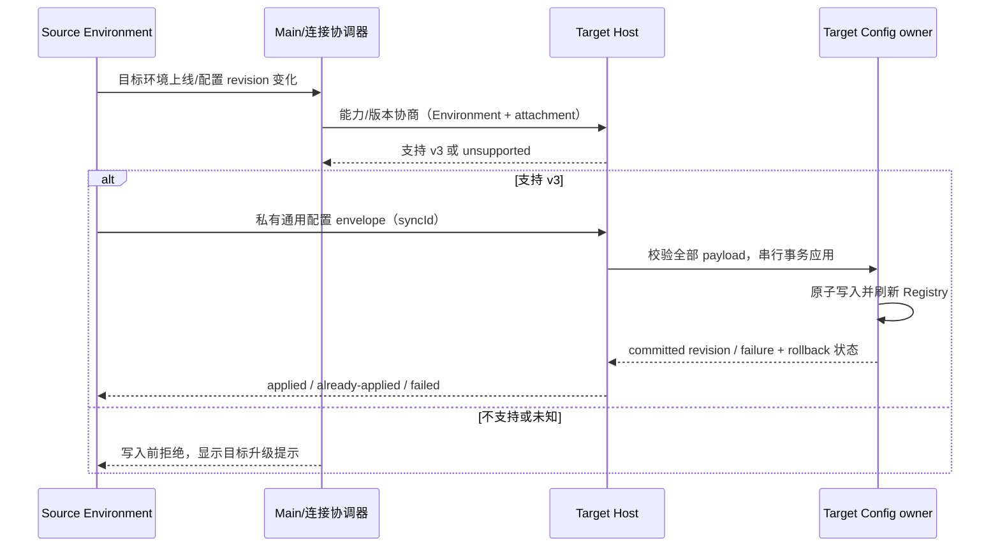

# 数据迁移、场景目录与验收矩阵

关联：[产品 spec](README.md)、[阶段和文件清单](implementation-phases.md)。状态：产品决策已确认，分阶段实现中；未通过的行为验收仍为未执行。

## 1. 决策记录与状态

| 记录 | 来源                                                                                        | 固定边界                                                                            |
| ---- | ------------------------------------------------------------------------------------------- | ----------------------------------------------------------------------------------- |
| C01  | 用户：“先把远端更新同步到本地，再基于 v3.15.1 重新分析……暂时不改功能源码”                   | 基于当前 `v3.15.1`；本次不改功能源码                                                |
| C02  | 用户：“彻底移除官方登录及关联云业务”                                                        | 删除应用官方 OAuth/JWT/账号域以及相关套餐、闲时、加速、分享、反馈、奖励、营销云业务 |
| C03  | 用户：支持 `anthropic-messages` / `openai-chat-completions` / `openai-responses` 的任意 API | 三协议可配任意兼容 endpoint；不新增第四种隐式协议                                   |
| C04  | 用户：按阶段列文件、保留功能、数据迁移和验收                                                | 交付本 spec 包；不执行真实数据迁移、不编写功能/E2E 代码                             |
| C05  | 源码和现有会话合同                                                                          | 保留独立鉴权、只读 Agent、明确模型身份、workspace/Host/实时链路隔离                 |

`accepted` 表示由已确认范围/既有不变量推导的目标行为已纳入本方案，**不表示用户已经评审过新测试，或实现/验证完成**。D01–D05 已获用户确认；其他未知旧数据不能通过猜测自动恢复。

## 2. 迁移原则和版本

v3.15.1 基线 Personal 文件 `provider_config.json` 使用 `schemaVersion: 1`（本增量编码已升级为 v2），形状为 `{ schemaVersion, config: { providerConfigRules, modelConfigRules, providerOrder?, defaultModelSelection? } }`。默认模型不在另一个文件中。

本增量升级到 Personal v2，以显式表达通用鉴权并拒绝被旧客户端误写；必须先执行 legacy 解码/迁移，才进入裁剪后的严格新 schema。基线 provisioning 是 v1/v2，本增量 v3 只传通用 Personal 配置、默认选择及必要的同步元数据，不带 accountSettings 或 OAuth credentials。两个版本数字分别属于两个合同，不能用一个 journal/version 替代。

S3 文件边界实施：Personal v2 编码，v1 先用 legacy 规则完整校验后转换；普通 access 显式补齐 authMode，旧专用 API-Key 转为普通 Key。旧标准鉴权头 override 转为 custom-headers 时补齐过去由 SDK 产生的其余鉴权头，再去掉独立 Key 字段，保持最终传输语义。损坏/未知字段/高版本在转换前拒绝，不写备份、不覆盖源文件。账号 Overlay 的最终精确裁剪仍在 producer 停止后的 S5，不将中间 v2 当作账号移除完成。

远端合同：Target 增加无 secret 的 `getCapabilities()`，返回 supportedSchemaVersions `[3]`。Window Host 在读取本地 secret 配置前先探测能力；缺方法/异常/不含 v3 一律 unsupported，不能调用 apply。v3 信封只带 schemaVersion、syncId、Personal config；新 Target 在启动 runtime/读取 owner/写入前拒绝 v1/v2。Target 不读取或写 settings/OAuth/凭据 Store。Personal 使用原锁 CAS 替换；刷新或 receipt 写失败只在目标内容仍匹配时回滚 Personal。receipt 不含 secret，syncId 与内容 hash 绑定，同 ID 不同内容拒绝；未知/损坏 receipt 保持原文件并拒绝新提交，不能按空表覆盖。响应仅包含阶段码及固定安全文本。

文件 Repository 持原锁重读后，在写 v2 前写私有 `<config>.generic-api-v1.backup.json`（只含配置，不含凭据 Store）及 `<config>.generic-api-migration.json`；journal 仅含 schemaVersion、stage、源/目标 hash、completedAt（全迁移完成前缺省），不含配置/自由错误文本。失败保留备份，后续读重试同一源 revision；发现备份所属 revision 不一致则停止转换，不覆盖恢复资料。v2 已提交而 journal 仍 pending 的重启只确认同一目标 hash，不覆盖新版本配置。只有最终 coordinator 明确记录整体完成后才从 completedAt 计算 30 天；本阶段不设置整体完成，也不自动删除失败资料。

- 迁移只访问应用既有数据根，使用路径工具/owner，不硬编码用户目录；测试使用隔离目录。
- 迁移期间使用既有私有文件锁/原子写入和各 SQLite 事务。跨 JSON/SQLite/凭据仓库没有一个通用 ACID 事务，必须逐 owner 提交并以 journal 可重入协调。
- journal 仅记录迁移版本、阶段、源/目标 revision、计数与错误类别，不复制原始 token、Key、headers 或用户会话。只在 owner 提交成功后标记该步骤完成。
- 失败时不发布整体完成，也不把旧数据清空。已经成功的步骤不能靠恢复全目录覆盖并发写入；后续启动按 journal/revision 重试未完成步骤。
- 先停止退休 producer、撤销 in-flight generation，再清理账号凭据。清理失败只报告 migration warning 并阻止账号功能复活；通用配置不受影响。
- 原始坏 JSON、未知 schema、高版本文件原样保留，返回修复/版本诊断；禁止“新 schema 解析失败 → 空配置覆盖”。配置无法解析时允许只读工作台，不执行损坏模型配置。
- JSON 配置转换可保留一份私有 pre-migration 备份，备份含普通 API secrets；访问权限必须与正式配置一致。备份位置由迁移 owner 定义；成功后的保留期为 30 天（D05），不能将其作为无权限的日志/附件。
- 不备份已明确删除的官方账号 token。降级到旧版本只能使用隔离恢复流程，旧版本不得读取/改写 v2；不会承诺恢复官方登录凭据或服务端权益。

## 3. 数据迁移清单

| ID / 数据                          | 唯一 owner / 现状                                                                                                        | 目标转换                                                                                                                                                                                                                | 保留/失败策略                                                                                                                                                 | 阶段                    |
| ---------------------------------- | ------------------------------------------------------------------------------------------------------------------------ | ----------------------------------------------------------------------------------------------------------------------------------------------------------------------------------------------------------------------- | ------------------------------------------------------------------------------------------------------------------------------------------------------------- | ----------------------- |
| M01 Personal provider/model rules  | Personal Repository；schema v1 同文件有 default                                                                          | v1 → v2；按 access/来源分类，不按厂商名称分类。普通 `api-key` 保留；可独立运行的 `zhipu-coding-plan-api-key` 转通用 api-key；账号派生 provider 移出可执行配置                                                           | providerId/modelId、名称、顺序、URL、headers、启停与手动能力不变。无独立 Key 的 account provider 不转换；退休信息仅留脱敏迁移报告/历史引用                    | S1 定合同，S3 实施      |
| M02 model selection/default/Recent | default 在 Personal；Recent、session、automation/profile 分属各 owner                                                    | 合法普通 default 原样保留；官方 default 移除并提示选择。既有显式 session/automation/profile 引用保存原身份，运行前诊断失效                                                                                              | 不按同名 modelId 映射其他源；未接受草稿不丢失；新 default 不批量改历史/队列。自动任务失效后不派发，普通任务可由用户修复                                       | S2/S3                   |
| M03 AppSettings 的官方域/连接      | settings owner；当前 schema 含 domain/connection selections                                                              | 清理 `providerFamilyDomain`、`providerFamilyDomainUpdatedAt`、`providerFamilyDomainMigrated`、`providerFamilyConnectionSelections`；legacy importer 中历史 `modelProviderFamilyModes` 等精确字段按存量解码清单转换/退役 | 主题、语言、更新偏好、proxy 等无关设置不动；禁止按字符串包含 family/user 全删。合法 legacy 字段先读再删，不先窄化 schema 导致整份丢弃                         | S3/S5                   |
| M04 官方账号 credentials           | CredentialService；OAuthRepo + account key store                                                                         | 删除 `zcodejwttoken`、`oauth:active_provider`、`oauth:login_attribution`；对 `zai`/`bigmodel` 删除 `oauth:{id}:access_token`、`refresh_token`、`user_info`；账号派生 key 按 account owner 产生/识别的精确集合清理       | 保留普通 API Key、MCP OAuth、SSH、Bots、QR/relay 授权、浏览器凭据。不能调用公共仓库 clearAll 或删除全部 `oauth:*`。不可解密时不尝试外发，记录固定错误码       | S4 停 producer，S5 清理 |
| M05 Off-Peak 本地记录/执行态       | `off_peak_tasks` 位于 tasks-index.sqlite；状态 queued/paused/running/completed/failed/cancelled，另有 schedulable/outbox | 停 scheduler/Host 云派发与核销后，非终态 queued/paused/running → cancelled，保存本地退役原因和 endedAt；schedulable false；完成/失败/取消终态不逆转                                                                     | 保留 offPeakTaskId、关联 conversation/session、workspaceKey/path/identity、正文与执行历史。不能把本地 cancelled 冒称云 ticket 已取消/核销；历史删除标记仍生效 | S3/S4                   |
| M06 Highspeed 历史                 | session 消息/metrics 与 UI hydration；专用 cloud access                                                                  | 移除新抽卡/发送 override；保留已持久化正文与必要的旧 metrics 解码；标识可退役                                                                                                                                           | 不删除普通消息、不将旧加速状态解释为可续用权益、不触发补抽/云分享                                                                                             | S4/S5                   |
| M07 分享/反馈/营销缓存             | 已导入 session/context；Feedback root/tickets.json；云缓存                                                               | 已导入内容和 provenance 本地可读；tickets 摘要/本地文件保留导出；营销/rewards 缓存不再启动业务                                                                                                                          | 不为补全文档发云 GET，不恢复后台上传；外部 URL 仅由用户主动打开。云端未下载正文无法在本地凭空恢复                                                             | S4                      |
| M08 MCP 预置与独立认证             | MCP config owner + official credential issuance                                                                          | 仅官方自动发放预置停用/标记退役；用户显式维护的普通 endpoint/auth 原样保存并按通用规则执行                                                                                                                              | 不删除全体 MCP、不清空 OAuth lease/token；普通工具 OAuth、SSH 和 Bots 认证不迁移为应用官方账号                                                                | S4/S5                   |
| M09 remote provisioning            | Source/Target 各 Environment config owner；当前 v1/v2                                                                    | 新 Source 只导出已完成迁移的通用配置。Target v3 验版本、校验通用 schema、按 syncId 幂等、写入后 refresh；不导出官方秘密                                                                                                 | 不兼容在任何写入前返回 unsupported；Target 失败回滚同事务受影响范围，rollback_failed 明确。未知 peer 不发送 v3 secrets；旧 Target 不被强制覆盖                | S3                      |
| M10 catalog/public cache/journal   | builtin release/cache、ClientConfig、migration coordinator                                                               | 内置/远端 catalog 去 account 业务；更新公共配置只保留公共字段；逐 owner journal 记录完成状态                                                                                                                            | 不删除普通 templates。过期 catalog 不能复活 account provider；无兼容目录用已验证 bundled fallback；不存在文件不按错误处理                                     | S3/S5/S6                |

M01 的特殊 Key 转换前必须证明该保存项是用户可独立调用的 Key+endpoint，而非临时 JWT 换得的账号 key；不能复制 M04 凭据来“完成”配置。遗留外部 `zcode`/opencode 导入入口同样不能重新生成 account provider。

M01 同步把普通 API 源的旧 family group 转为通用分组，保留厂商展示元数据；providerOrder 只移除退休 ID，其余相对顺序不变。跨普通/账号源的共享 model rule 必须拆解其有效作用范围，不能因匹配到一个 account provider 就删除整条仍作用于普通源的规则；转换前后验证每个保留源的 effective config。

M04 当前 account 物理 key 由 `accountProviderCredentialKey()` 生成，含 plan/provider/account 和可能的 product/org/project。实施时须覆盖现行与已存在的 legacy 形式，通过已知 owner/key parser 精确识别；不使用无边界 `account` 字符串匹配，且清理计数不打印 key 中的账号身份。

### 3.1 迁移与云任务退出时序

升级时若旧进程还在执行官方请求，必须由现有 session owner 正常停止/终结，保存已有输出，再进行本地取消迁移；不能从 Main 直接伪写 session 状态。发行前可在旧客户端安排云取消/核销或由后台管理侧处理，但新版本不为迁移保留云 cancel/settle 调用。仅靠本地迁移无法保证服务器 ticket、工单或分享被删除；这些外部数据按原服务生命周期处理，是否需要额外云侧清理见 D05。

### 3.2 远端时序与身份隔离

配置按 Environment 同步；会话按 workspaceIdentity/remoteSessionId/attachment 路由，二者不能混为同一个 path key。断连不表示配置应用成功。手机重连继续现有 `web-remote-replayable` snapshot/replay；桌面保持 `desktop-continuous` 流，不因新增配置版本改成重放。

| Source / Target                          | 目标结果                                      | 数据副作用                                                      |
| ---------------------------------------- | --------------------------------------------- | --------------------------------------------------------------- |
| v3 / v3                                  | 验证并应用通用配置；相同 syncId 幂等          | 只有成功验证后的 Target owner 可提交                            |
| v3 / 旧 v1/v2 或能力未知                 | 提示升级/unsupported，不发送 v3 私有 envelope | 不改 Target 配置/credentials；不自动降级为含账号的旧信封        |
| 旧 v1/v2 / v3                            | 拒绝旧账号信封，提示升级 Source               | 不应用 accountSettings/OAuth；Target 自己的本地升级迁移另行完成 |
| v3 / v3，但 Target 已迁移失败/读到高版本 | 固定阶段错误并保留当前数据                    | 不以空配置替换；回滚与 rollback_failed 显式上报                 |

## 4. 范围维度和组合剪枝

主要领域限定为：provider/config/execution、startup/default/readiness、cloud retirement/persistence、remote/auth/recovery。工具与插件/Bot/Subagent 以边界回归覆盖，不展开全功能笛卡尔积。

| 维度        | 等价类                                                                      | 处理                                                                          |
| ----------- | --------------------------------------------------------------------------- | ----------------------------------------------------------------------------- |
| 入口        | 首次、手动设置、空草稿、历史会话、automation/Subagent/Bot                   | 共用字段但分别证明 commit sink；默认不得跨 owner 写入                         |
| 数据基线    | 干净、普通 API、纯官方、混合、损坏、未知高版本、旧云历史                    | 全部有迁移/启动代表场景                                                       |
| 协议 × 鉴权 | 三协议 × api-key/custom-headers/none                                        | 九种传输正向合同需逐组合证明；复杂工具/恢复用三协议代表，不对全部 UI 再乘九倍 |
| 运行态      | draft、running、queued、历史只读、后台任务                                  | 重点覆盖 default/禁用/删除 provider 与已接受输入边界                          |
| 平台/交付   | Windows/macOS/Linux；本地/SSH；desktop-continuous/mobile replayable         | UI 代表按平台执行；时序和身份高风险组合不得合并                               |
| 故障        | 保存失败、default 失败、401/429、流中断、断连、migration 半提交、高版本拒绝 | 通过故障屏障而非固定 sleep 驱动                                               |

| 候选/剪枝 ID | 组合                                              | 状态                       | guard / 原因                                                                  | 代表场景       |
| ------------ | ------------------------------------------------- | -------------------------- | ----------------------------------------------------------------------------- | -------------- |
| P01          | 官方 OAuth × 所有套餐/组织类型 × 新协议           | pruned                     | 新产品无官方登录/权益入口，无需继续实现所有账号排列；混合历史仍必须迁移       | 17、18、26、35 |
| P02          | 零模型 × send/prewarm/执行型 automation           | accepted                   | 配置完整性是共同准入；UI 与后台提交 owner 各验证                              | 02、14、24     |
| P03          | 零模型 × 历史 task/session 读取                   | accepted                   | 只读 Agent 合同必须保留，不能与 P02 一起剪掉                                  | 02、03         |
| P04          | 三协议 × 三鉴权 × 全部 UI/主题/语言               | pruned（只剪重复 UI 组合） | wire 九组合保留；共用表单代表验证多语言/响应式，不能剪掉独立 auth 效果        | 04–11、34      |
| P05          | 相同 modelId × 不同 providerId × 默认/历史/remote | accepted                   | 身份严格，禁止跨厂商重绑                                                      | 13、18、32     |
| P06          | 所有模型模态 × 所有工具/插件                      | pruned（只剪全量乘积）     | 按能力打开；选择不支持的能力须阻断/提示，代表模型覆盖工具/图片/PDF 等必要边界 | 09、10、16     |
| P07          | 独立 MCP OAuth/SSH/Bots × 官方 credential 清理    | accepted                   | 共用凭据仓库的高风险交集，不属于官方账户删除范围                              | 19、28、32、38 |
| P08          | 未知 legacy 字段或不可恢复云 payload 的猜测性修复 | undefined                  | 无已知解码证据不能自动映射；保持原数据并诊断                                  | 20、21；D05    |
| P09          | HTTP API 被直接当成任意动态鉴权协议               | pruned                     | 当前三协议目标不含 OAuth/SigV4/mTLS 通用实现；不可宣称兼容                    | 11、36         |
| P10          | 独立 ARMS/全部公共分发迁移                        | pruned（已确认 D01/D02）   | 云上报默认关闭；公共服务本轮保留，自托管/全部迁移另案                         | D01、D02、37   |

## 5. 纳入方案的验收场景

下表 IDs 为 `API-ONLY-01` 至 `API-ONLY-40`，后续复用不重新编号。全部 `accepted / planned`，验证状态均为 **未执行**。UI 交互测试编写后先进入 manual-review/pending，不能凭本文或已有测试路径晋升 CI verified。

| ID          | 准备                                                              | 操作                                     | 必须断言                                                                                                                    | 证据层/阶段                                       |
| ----------- | ----------------------------------------------------------------- | ---------------------------------------- | --------------------------------------------------------------------------------------------------------------------------- | ------------------------------------------------- |
| API-ONLY-01 | 干净本地安装，无域/账号/源                                        | 首次启动                                 | 通用配置显示三协议与自定义源；无注册/OAuth；可跳过；无云业务请求                                                            | Desktop UI + 网络 / S2/S5                         |
| API-ONLY-02 | 01 点跳过、已有/新草稿                                            | 写草稿、点发送、等待原预热触发点         | 草稿保留，配置入口可见；模型请求为零、无 draft 执行 session/预热；历史读取不被禁用；不写虚构 domain/provider                | UI + Host/CLI + 文件 / S2                         |
| API-ONLY-03 | 无可执行模型但有历史 task/session                                 | 启动后读列表、正文、重启                 | 列表/正文正常；可用既有只读 Agent；不会因为历史读取发模型请求/创建重复 Agent                                                | UI + RPC/进程 + 网络 / S2                         |
| API-ONLY-04 | 三协议各一个 api-key 假服务                                       | 保存源和手动 model，测试并发送           | 每协议直达指定地址，正确协议路径/body/鉴权、流式正文和 usage；无官方 JWT/重写                                               | adapter wire + Desktop / S1                       |
| API-ONLY-05 | 三协议各一个 none 服务；进程有测试用 SDK env Key                  | 保存、连通性/发送                        | 不要求假 Key；无 Authorization/x-api-key，不读取 env fallback；九组合中的 none 三项独立通过                                 | adapter wire / S1                                 |
| API-ONLY-06 | 三协议各一个 custom-headers 服务                                  | 设置自定义认证头、保存/重启/发送         | 仅显式 auth 生效；无自动 Key/JWT；通用必要头正确；秘密在日志/报告脱敏                                                       | adapter + persistence / S1                        |
| API-ONLY-07 | 带/不带 `/v1`、尾斜杠、代理前缀与普通 Z.ai/BigModel endpoint      | 用每协议构造实际请求                     | 最终路径合同稳定、不重复 `/v1`，不转官方网关；前缀不丢失                                                                    | adapter URL + network / S1/S5                     |
| API-ONLY-08 | 非 URL、嵌入 credentials、header CR/LF、与自动 auth 冲突          | 保存/测试                                | 明确字段错误；不执行请求、不提交非法配置；草稿保留；无日志秘密                                                              | UI + schema + 文件 / S1                           |
| API-ONLY-09 | 三协议支持工具的模型 fixture                                      | 发起一次工具请求并续轮                   | 参数、调用/结果配对、权限、后续流与 usage 正常；请求 endpoint 始终为用户源                                                  | UI + runtime + wire / S1/S6                       |
| API-ONLY-10 | 无 reasoning/不支持工具或部分模态的手动模型                       | 保存、选择，发送支持/不支持的操作        | 完整选择能创建；无虚假 reasoning wire；工具/模态按能力准入，错误可诊断                                                      | config + runtime/wire + UI / S1                   |
| API-ONLY-11 | 401/403/429、错误 SSE、流中断、空流及取消 fixture                 | 测试、发送、取消/重试                    | 保留通用错误/恢复语义；不重登、不导向套餐、不自动换协议；取消无后续迟到输出污染                                             | adapter + runtime + UI / S1/S5                    |
| API-ONLY-12 | 首次配置，无已选项目                                              | 保存源/模型并设默认，关闭后重启/发送     | default 正式落同文件；真实默认 cwd 幂等；未选择项目 UI 保留；重启无需登录                                                   | UI + 文件 + CLI cwd/wire / S2                     |
| API-ONLY-13 | A/B 源同 modelId，workspace Recent=A，会话 Active=A               | 手动设全局 default=B                     | 新未指定草稿按 default；已有 Recent/Active/显式 automation/Subagent 不被改写                                                | UI + repo + runtime / S2                          |
| API-ONLY-14 | draft 或后台任务引用 disabled/deleted/missing provider            | 尝试发送/触发 scheduler                  | 执行 owner 阻断，展示修复；不按同名 model 自动改源；草稿/记录保留                                                           | UI + scheduler/runtime + 文件 / S2/S3             |
| API-ONLY-15 | provider 保存成功、default 写失败或刷新失败屏障                   | 点击保存并设默认，然后重试               | 显示部分完成；复用 providerId、不重复创建；失败不能关闭成“已可用”；不靠 sleep 完成                                          | UI + service + 文件 / S2                          |
| API-ONLY-16 | 正在工具/权限等待或已有 admission 队列                            | 修改默认/headers/启停配置                | 不批量替换已创建 Active Model/已接受输入；后续选择变化遵守原 runtime 生命周期，stale run 防护仍在                           | runtime/protocol + wire / S2/S6                   |
| API-ONLY-17 | v1 普通 API 文件与普通 default                                    | 升级两次、并发读/重启                    | v2 只迁一次；普通 ID/Key/URL/headers/能力/默认/顺序保持；journal 无秘密                                                     | fixture + repository/files / S3                   |
| API-ONLY-18 | 纯官方、混合源、账号 default/session/automation 引用              | 升级后读历史、启动新草稿/触发任务        | 普通源完整保留；账号源不可执行；历史可读；失效显式引用需修复，不跨厂商映射                                                  | migration + UI/runtime + 文件 / S3/S5             |
| API-ONLY-19 | 官方与 MCP/SSH/Bot/QR/浏览器凭据共存                              | 停 producer 后精确迁移清理               | 只删除 M04 已知官方集合，独立 credentials 字节/身份不变；不调用 clearAll                                                    | credential fixture + 连接回归 / S3/S5             |
| API-ONLY-20 | JSON 损坏、非法 rules、未知 schema、高版本                        | 升级/保存失败                            | 原文件原样保留；无空配置写入；诊断准确；只读工作台可达                                                                      | file fault + UI / S3                              |
| API-ONLY-21 | 在 JSON/SQLite/secret 各提交前后注入故障，两个 writer             | 重启恢复/重试                            | journal 只确认已提交阶段；owner 锁/事务有效；不覆盖并发用户写；失败不宣称全局成功                                           | migration fault + files/DB / S3                   |
| API-ONLY-22 | 闲时 queued/paused/running 及三类终态、关联 session               | 升级、打开历史                           | 非终态本地取消并 schedulable=false；running 由 session owner 正常收尾；终态不逆转、历史/关联内容不删；无取号/核销/续跑      | DB + UI + scheduler/network / S3/S4               |
| API-ONLY-23 | 已有 Highspeed 正文/metrics、旧加速缓存                           | 升级、读历史、下一轮普通发送             | 正文可读；不恢复抽卡/override/云分享；旧 metrics 解码不崩溃                                                                 | session fixture + UI/wire / S4                    |
| API-ONLY-24 | 普通 cron 和 Off-Peak 记录共存                                    | 打开自动任务设置/触发普通 cron           | cron 编辑/调度保持，旧闲时不派发；不往 automation 添 retired 字段                                                           | UI + scheduler + DB / S4                          |
| API-ONLY-25 | 反馈 tickets 摘要、已导入 share context/附件、本地 logs           | 升级、浏览/本地导出                      | 可保留内容不删；无自动补下载/上传；未下载云正文明确不可本地恢复                                                             | 文件/session + UI + 网络 / S4                     |
| API-ONLY-26 | 有/无旧账号与 domain，云服务缓存存在                              | 冷启动、窗口切换、任务结束、401          | 无账号/套餐/闲时/加速/反馈/分享/营销/奖励 producer 或请求；无后台登录弹窗                                                   | UI/service registration + 网络 / S4/S5            |
| API-ONLY-27 | 保留本地模型 usage/context 记录                                   | 三协议对话，查看用量/上下文              | 本地 usage/context 正常，云套餐/重置/购买卡片不存在                                                                         | UI + usage persistence / S4/S6                    |
| API-ONLY-28 | 普通 MCP stdio/http、独立 OAuth 与官方预置并存                    | 升级并调用普通工具/授权刷新              | 普通 transport/OAuth 正常；官方自动发放/额度请求为零；不能删全体 MCP 配置                                                   | config + MCP wire + UI / S4/S5                    |
| API-ONLY-29 | 云分享/Feedback/Rewards/官方 OAuth 旧深链                         | 启动后打开各深链                         | 明确退役或受控拒绝；不自动登录、不发送 secrets、不唤起退休 Webview；普通 workspace 深链保留                                 | main/preload + UI + 网络 / S4/S5                  |
| API-ONLY-30 | 老 OAuth 回调/云 poll 响应尚未完成                                | 停 producer/迁移后释放旧响应             | generation 失效；无 user/provider 再写入、无重复通知/上传/登录 reopen                                                       | service race + UI/文件 / S4/S5                    |
| API-ONLY-31 | 公共目录返回含 account provider 的旧配置                          | 刷新/重启                                | account 源不回流，普通模板保留；不兼容用验证的 bundled fallback；不读官方 credentials                                       | catalog fixture + Registry / S1/S5                |
| API-ONLY-32 | 两个 SSH Host、相同 path 不同 workspace identity，手机 attachment | 修改源/默认并发同步、各端发送            | 目标配置按 Environment；会话按 identity/remoteSessionId/owner/lease；请求不串 Host；秘密不进 relay 日志                     | multi-Host UI + protocol/wire / S3/S6             |
| API-ONLY-33 | 新 Source/Target v3、旧/未知 peer、重复 syncId、Target 失败       | 协商并同步、断连重试                     | 不兼容写前拒绝/不发 secrets；幂等；commit/refresh/rollback 状态正确，失败不假报 applied                                     | protocol + Target files + fault / S3              |
| API-ONLY-34 | zh-CN/en-US、深浅色、desktop 与手机视口                           | 首次设置/模型错误/修复入口               | 厂商默认不被 locale 固定；复用组件；布局文案与平台服务正确；手机不跑本地注册向导                                            | Desktop/mobile UI / S2/S6                         |
| API-ONLY-35 | standalone CLI 旧账号与普通配置两套 fixture                       | 启动/config/运行通用模型                 | 无官方 OAuth/bootstrap/runtime key 解析；普通 API 同 Desktop 模型选择/endpoint 合同                                         | CLI process + wire/files / S5                     |
| API-ONLY-36 | HTTP localhost/HTTPS、自建 proxy、CA、超时/取消                   | 三协议模型调用                           | 显式配置 endpoint 可用；proxy/TLS/cancel 公共边界保留；不宣称未实现的动态鉴权                                               | adapter/transport / S1/S6                         |
| API-ONLY-37 | 已定公共网络 allowlist；干净/升级数据                             | 启动、目录更新、对话、任务完结、设置操作 | 仅配置模型、用户工具及允许公共请求；无官方业务 event/agent trace/上传；独立云上报按 D01 验证                                | network capture + local diagnostics / S6          |
| API-ONLY-38 | 普通 Bot/Subagent/插件配置带明确模型与独立 token                  | 升级、Bot 输入/Subagent 调用/插件工具    | 各 owner/auth/权限不变，明确模型不被 default 覆盖；服务记录和实际 wire 一致                                                 | Bot/Subagent/tool + wire / S6                     |
| API-ONLY-39 | Desktop 连续流、mobile replayable，同会话 disconnect              | 流中断重连/权限/队列运行期间配置变化     | Desktop 流不变成 replay；mobile snapshot/replay无重复输出；busy input仍由 CommandInbox admission，owner/lease/stale防护保留 | 两种 delivery 协议 + UI/runtime / S3/S6           |
| API-ONLY-40 | 并发旧客户端尝试写 v2、备份/迁移半完成后降级                      | 重启/受控恢复                            | 旧版不误写 v2；恢复流程隔离、不覆盖迁移后新数据；不承诺恢复官方 secrets/云状态                                              | version fault + files + release procedure / S3/S6 |

## 6. 覆盖矩阵与现有证据

S1 交互候选（API-ONLY-04/05/06/08/34 的设置表单部分）：`packages/desktop/test/e2e/conversation-session/manual-review/pending/generic-api-auth-settings.test.ts`。准备使用无应用账号凭据的隔离 E2E profile、普通 replay provider；通过真实设置 UI 在三协议之间切换、选择三鉴权、编辑/隐藏请求头、提交无效 JSON 后修复、关闭重开设置。断言 Personal 文件中的 authMode/Key/headers、协议和源 ID；本候选不发送模型请求，不能单独计作三协议执行或手机覆盖。对应实际 wire 由 adapter tests 提供，后续 S6 合并真实 UI/请求证据。状态 manual-review/pending，不自动晋升；实际运行结果见阶段证据。

| 场景             | spec 状态        | 所需实现/证据                                                   | 当前可复用路径                                                                                                                                                            | 当前验证状态                              |
| ---------------- | ---------------- | --------------------------------------------------------------- | ------------------------------------------------------------------------------------------------------------------------------------------------------------------------- | ----------------------------------------- |
| 01–03、12–16、34 | accepted/planned | setup/default/readiness 单测 + Desktop/mobile UI、RPC/文件/请求 | `packages/ui/test/rootStartupGate.test.ts`、`v4DraftModelReadinessGate.test.ts`；`packages/desktop/test/e2e/provider-readiness-agent-startup.test.ts`                     | 未实现新合同、未执行未来场景              |
| 04–11、36        | accepted/planned | 九个协议鉴权组合、工具/usage、URL/header/错误 wire              | `apps/zcode-cli/packages/adapters/tests/model-execution.test.ts`、`provider-endpoint-routing-fetch.test.ts`                                                               | 未实现新鉴权/直达合同、未执行             |
| 17–21、40        | accepted/planned | 混合 legacy fixture、原子性、精确删除、故障/并发恢复            | `packages/provider-node/test/`、`packages/ui/test/providerFamilyDomainMigration.test.ts`                                                                                  | 当前迁移只证明旧合同；新迁移未实现/未执行 |
| 22–31            | accepted/planned | producer 退役、历史 decode、普通 cron/MCP/usage 回归            | `packages/services/test/offPeakTaskRepo.test.ts`、`feedbackLocalTicketStore.test.ts`；现有共享 UI/Service                                                                 | 未实现退役、未执行                        |
| 32–33、39        | accepted/planned | v3/旧 peer、Target rollback、跨 Host identity 和两种 delivery   | `packages/services/test/providerProvisioningFileIntegration.test.ts`、`providerProvisioningSource.test.ts`、`providerProvisioningTarget.test.ts`；remote E2E 在实施前重核 | v3 未实现、未执行                         |
| 35、37–38        | accepted/planned | CLI/网络 allowlist/普通 Bots/Subagents/插件回归                 | `apps/zcode-cli/packages/bootstrap/tests/provider-registry-app-runtime.test.ts` 与各业务现有测试                                                                          | 未实现退出/发行合同、未执行               |

已知基线调查证据：同步 v3.15.1 后，既有 UI/provider 相关 7 个测试文件共 41 项通过（登录/可用性/默认选择/域迁移/启动/readiness）；根 typecheck 通过，lint 0 errors / 62 warnings。这些只说明**当前源码基线**，不能转换成 API-ONLY 场景通过。实际厂商 API、Desktop E2E、手机/SSH 和三平台本次未跑。

### E2E 实施交接

- 新测试首先进入 manual-review/pending；通过人工用例评审、实际回放/夹具和 CI admission 后再更新 verified 状态，不修改既有 coverage 审计规则来“通过”。
- 假 provider 分别支持三协议的真实 wire，验证最终 URL、敏感头（只比对测试值）、tool/usage、401/429、断流和 cancellation；可控故障屏障用于保存、刷新、回调和远端 rollback，不以固定 sleep 代替事件顺序。
- 文件 fixture 包括 v1 普通/官方/混合/高版本、私有凭据集合、SQLite 闲时状态、已导入 share/highspeed 历史；不从真实用户目录复制数据。
- UI 截图只证明 surface，必须同时附文件/Host/CLI/provider 请求证据。无请求断言覆盖需要模型的发送/预热/云 producer；不能错误地要求没有历史读取 Agent。
- Desktop 使用目标包现有 `test:e2e` 入口；独立 CLI/adapter 测试以对应 `package.json` 为准。远端/手机、三平台和真实厂商 smoke 分别记录证据与环境限制；本 spec 不新增生产测试钩子。
- 将实现文件、运行 ID、证据、失败/跳过原因回填本文矩阵与总会话目录。初次文档交付时未创建测试；后续新增的 pending 用例与执行证据见 §9，尚未晋升 CI。

## 7. 已确认决策

2026-10-12 用户确认：D01–D05 全部采用推荐方案，备份保留 30 天；先更新 spec，再按阶段实现。以下决定替代此前的 undefined 状态；确认不代表实施或验收完成。

| ID  | 已确认方案                                                                                                                                    | 实施边界与影响                                                                                                  |
| --- | --------------------------------------------------------------------------------------------------------------------------------------------- | --------------------------------------------------------------------------------------------------------------- |
| D01 | 独立崩溃/性能云上报默认关闭；本地日志、性能数据和诊断导出保留；本轮不增加 opt-in 开关                                                         | S4/S6 证明无默认云上报；未来 opt-in 须另定义设置、内容及上传边界                                                |
| D02 | 本轮保留无账号的公共更新、插件/模型目录、ClientConfig 和远控 relay；自托管另立方案                                                            | 公共接口 allowlist，不带应用登录凭据，不重新生成账号 provider；离线/缓存与配对鉴权保持                          |
| D03 | 优先复用完整 ModelSelection：无 reasoning 模型采用内部中性单值和空参数映射，请求不发送 reasoning 参数                                         | S1/S2 必须验证实际 wire；仅当现有表达不足时更新合同/测试再调整类型，不填虚假的厂商推理参数                      |
| D04 | 记住跳过，跨启动直接进入工作台；无模型持续提示配置并阻止发送/预热，保留草稿和历史                                                             | 偏好由 settings owner 持久化和广播；不写假账号域，不修改 session/Recent/default                                 |
| D05 | migration journal 可重入、无秘密；仅保留配置的私有备份；迁移成功后保留 30 天，失败迁移资料不自动清理；未知/损坏数据原样保留；云侧清理独立安排 | 30 天从全部必要迁移成功时间起算；只清理本迁移拥有的备份；不备份退休官方 token；不通过新客户端重新接入退休云接口 |

D05 的原文件损坏/未知高版本诊断不受备份到期策略影响。备份不得进入上传、日志或测试产物，普通 API 密钥访问权限与正式私有配置一致。迁移阶段提交、journal 和最终完成时点遵循 §2/§3 的 owner 事务顺序。

## 8. 初次文档交付检查（历史）

本次只检验文档格式、路径、场景编号和索引一致性，另执行仓库要求的根 typecheck/lint。实际执行结果由任务最终回复记录；未执行的未来行为检查保持未执行，不把文档编译成功当作迁移或协议验收成功。

2026-10-12 文档交付验证：`pnpm typecheck` 通过；`pnpm lint` 为 0 errors / 62 warnings。新 spec 包与登录文档的定向 `oxfmt --check` 通过；135 个现存路径、4 个明确标为拟新增的文件、12 个文档链接、7 个阶段、10 项迁移、40 个唯一场景已核实。两份既有总目录和功能图存在基线格式问题，已用 HEAD 副本复核，未做无关全文件重排；功能图基线的 4 条悬空关系详见主 spec。本次未执行未来功能测试/E2E/用户数据迁移。

## 9. 分阶段增量证据

实际状态见 [实施进度](implementation-phases.md#实施进度与实际证据2026-10-12)。API-ONLY-04/05/06/07/08/09/10 已有配置/adapter 层部分证据；API-ONLY-04/05/06/08/34 的桌面设置子路径 pending E2E 1/1 通过。九协议鉴权组合覆盖请求 URL/头/正文/usage，三协议补流式和工具输入；这不证明完整 UI 会话、权限、取消/故障、真实厂商、多平台或 remote/mobile 已通过。S2 追加首次/手动通用向导、默认原子写入、skip 两次冷重启 E2E；S3 追加 v2 文件/私有备份/hash journal、v3 无账号同步与旧 peer 拒绝、CAS 和 receipt 提交前后故障；D01 追加 SDK 未初始化及本地崩溃/资源诊断回归。完整运行证据和剩余范围见实施进度，未证明的断言保持 planned，40 项场景不整体标绿。
